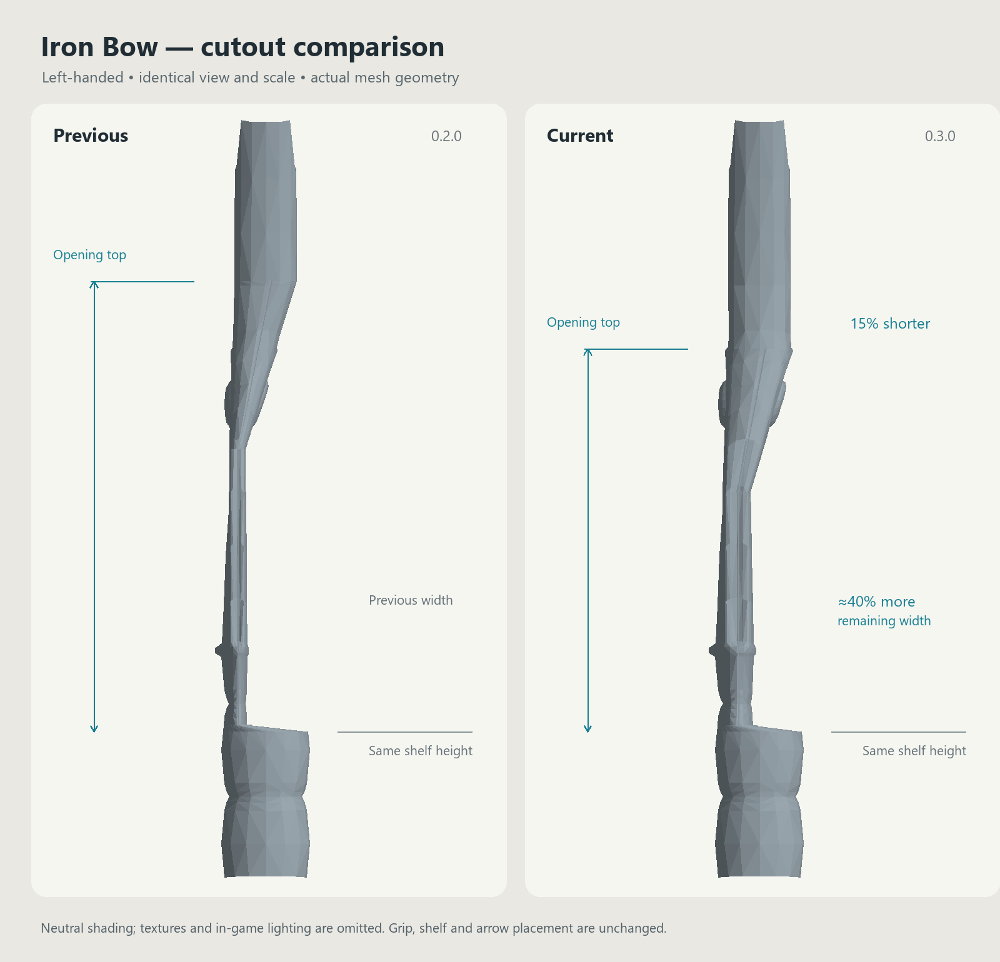

# Bow Sight Windows VR

Sight windows for Skyrim VR bows, with an arrow shelf and a narrower section above the grip for a clearer view along the arrow. A FOMOD installer selects left- or right-handed meshes for the whole set.



**Current version: 0.3.0. Public download: source and tools only.** The locally installed mesh mod is complete; the bundled mesh archive remains local while upstream redistribution permissions are reviewed. No game files or modified third-party NIFs are stored in this repository or attached to its releases.

## What the mod changes

- A cutout beginning beneath the existing drawn-arrow position, with a thinner section above it.
- Left-handed: bow in the **right** hand, string drawn with the **left**.
- Right-handed: bow in the **left** hand, string drawn with the **right**.
- Vanilla Skyrim, Dawnguard and Dragonborn bow families, Bound Bow, Drainspell Bow and unique-model variants used by the reference setup: **34 mesh paths per hand**.
- Version 0.3.0 restores material for approximately **40% more remaining width**, and lowers the top of the opening for **15% less height**. The shelf height stays fixed.

The mod installs meshes only. It keeps the source skeletons, grip and arrow placement, collision, animation references, materials and original vertex weights. It does not change aiming, draw speed, damage, ballistics, or Bow Inertia VR code/settings. A global mesh choice also affects NPC/world appearances that share those models.

## Scope and compatibility

This reference build was made against an existing **MGO setup**, using Cathedral Armory, Vanilla Weapon Replacer SSE, PGPatcher output and some Legacy of the Dragonborn unique models. It is not a standalone replacement for every possible vanilla/replacer installation. Keep the matching textures and materials. Crossbows and NPC-only dummy bows are excluded. The pictured `ironbow.nif` is the Imperial Bow model in the game records.

The tool currently accepts the exact source hashes in [reference_sources.json](reference_sources.json), SSE NIF stream 100, one skin partition per shape, 40/44-byte vertex layouts and identity bone palettes. Unsupported inputs fail explicitly. It does not automatically adapt unrelated bow replacers.

## Build a local FOMOD

Use Python 3.10 or later. The core builder uses only the standard library.

1. Obtain the source mods through their original distribution pages and keep them installed locally.
2. Assemble an untouched source folder whose contents match the relative paths and SHA-256 values in `reference_sources.json`. Paths are relative to `meshes/`; do not use this sight-window mod's already-modified NIFs as inputs. Unique files packed in BSAs need to be extracted locally with your preferred asset tool.
3. Run:

```powershell
python tools/build.py --source-dir "D:/Modding/BowSources" --output-dir "D:/Modding/BowSightWindowsBuild"
```

The builder generates 68 meshes, checks every result against the verified 0.3.0 output hashes, and creates a local `BowSightWindows-VanillaDLC-MGO-0.3.0-FOMOD.zip`. It does not modify MO2, a game installation, or the source folder. Source and output folders must be separate and non-nested.

Install that locally generated ZIP through MO2, choose one handedness, and let it win conflicts with the source bow meshes/PGPatcher output. Disable the older Long Bow-only sight-window mod. Reinstall and replace to switch hands; disable the mod to restore the underlying meshes.

## Verification

All 68 reference outputs passed offline checks for valid geometry and bounds, preserved original UVs/weights, unchanged skeleton/material/collision blocks and exclusive FOMOD routing. The original left-handed Long Bow and 0.2.0 appearance received user approval in-game. Revised 0.3.0 proportions were reviewed in a geometry render; right-handed placement and all live effect combinations have not been exhaustively headset-tested.

Bound Bow's flame/refraction surfaces follow the opening. Newly added effect vertices use the engine's four-influence limit; the largest discarded interpolation influence is approximately 6.42%, confined to new effect-sheet vertices. Original weights remain untouched.

Run the source-only tests with:

```powershell
python -m unittest discover -s tests -v
```

## Nexus preparation and credits

[Nexus draft and upload checklist](docs/nexus/README.md) · [BBCode description](docs/nexus/description.bbcode) · [Credits and asset permissions](docs/ASSET_PERMISSIONS.md) · [Changelog](CHANGELOG.md)

The original tools and documentation are MIT-licensed. Bethesda and upstream creators retain their asset rights. Public release assets intentionally contain no NIF/BSA/DDS files; the third-party mesh FOMOD is not approved for redistribution by this repository's MIT license.
